<div align="center">

```
██████╗ ██╗    ██╗ █████╗ ██╗   ██╗███╗   ██╗███████╗
██╔══██╗██║    ██║██╔══██╗╚██╗ ██╔╝████╗  ██║██╔════╝
██║  ██║██║ █╗ ██║███████║ ╚████╔╝ ██╔██╗ ██║█████╗
██║  ██║██║███╗██║██╔══██║  ╚██╔╝  ██║╚██╗██║██╔══╝
██████╔╝╚███╔███╔╝██║  ██║   ██║   ██║ ╚████║███████╗
╚═════╝  ╚══╝╚══╝ ╚═╝  ╚═╝   ╚═╝   ╚═╝  ╚═══╝╚══════╝
```



</div>

<br>

## `$ ls stack/`

<div align="center">


</div>

<br>

## `$ cat stats.log`

<div align="center">


</div>
